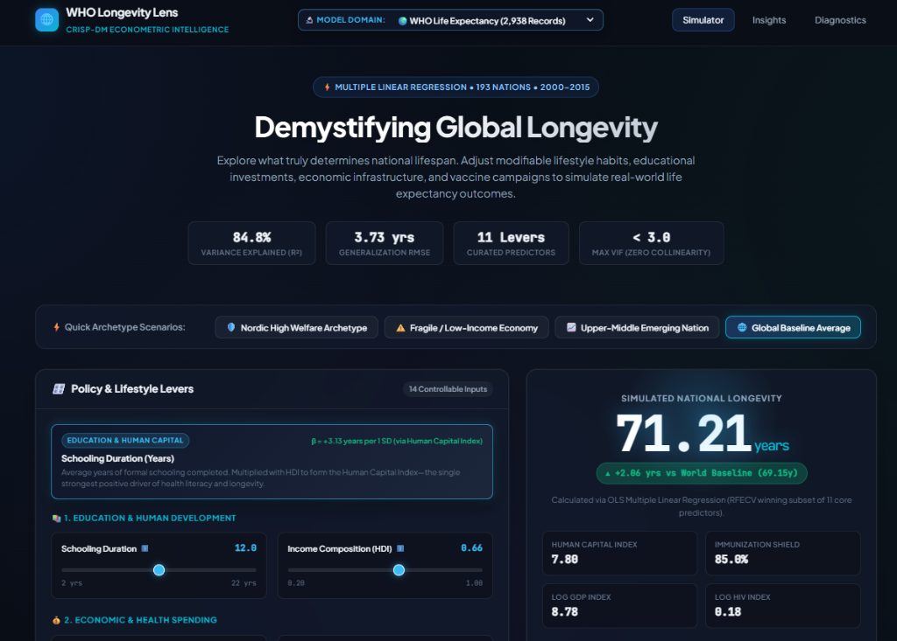
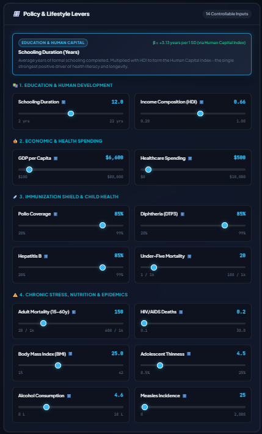
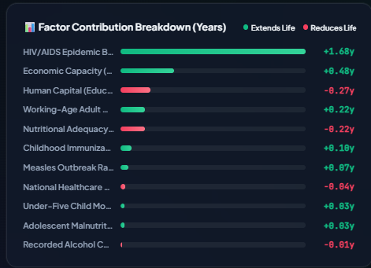
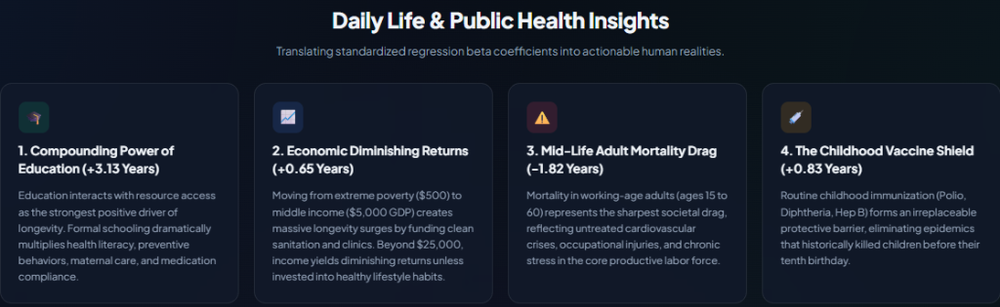

# 🌐 Dual Health Intelligence Studio: CRISP-DM Econometric & Clinical Modeling

[](https://www.python.org/)
[](https://fastapi.tiangolo.com/)
[](https://scikit-learn.org/)
[](https://www.statsmodels.org/)
[](https://en.wikipedia.org/wiki/Cross-industry_standard_process_for_data_mining)
[](LICENSE)

An end-to-end, econometrically rigorous **Multiple Linear Regression (MLR)** intelligence studio developed under the **CRISP-DM (Cross-Industry Standard Process for Data Mining)** methodology. The system features a responsive, glassmorphic **FastAPI web application** with an interactive **dual-domain selector dropdown (`下拉式選單`)**, enabling real-time counterfactual policy simulations and sleep hygiene analysis.

---

## 📸 Interactive Web Application Overview



The application provides an interactive web interface powered by **FastAPI**, featuring real-time parameter simulation, an intuitive **Feature Explorer Banner**, instantaneous outcome recalculation, and a dynamic **Factor Contribution Waterfall Chart**.

---

## 🔬 Dual Model Domains

The studio hosts two full-scale regression models accessible via the top-navigation dropdown menu:

| Dimension | Domain 1: WHO Global Longevity | Domain 2: Sleep Health & Quality |
| :--- | :--- | :--- |
| **Dataset** | [`Life Expectancy Data.csv`](file:///c:/Users/User/Desktop/Hw2/Life%20Expectancy%20Data.csv) | [`sleep_health_dataset.csv`](file:///c:/Users/User/Desktop/Hw2/sleep_health_dataset.csv) |
| **Cohort Size** | 2,938 records (193 nations, 2000–2015) | 100,000 individual records (32 variables) |
| **Target ($y$)** | `life_expectancy` (Continuous, in years) | `sleep_quality_score` (Continuous, 1.0 to 10.0 scale) |
| **Curated Predictors** | **11 core features** ($8 \le k \le 12$) | **11 core features** ($8 \le k \le 12$) |
| **Test Explanatory Power** | **$R^2 = 0.8391$** (Adj $R^2 = 0.8360$) | **$R^2 = 0.7619$** (Adj $R^2 = 0.7617$) |
| **Generalization Error** | **$\text{RMSE} = 3.73$ years** ($\text{MSE} = 13.92\text{ yrs}^2$) | **$\text{RMSE} = 0.739$ points** ($\text{MSE} = 0.547\text{ pts}^2$) |
| **Multicollinearity Ceiling**| $\text{VIF} < 3.0$ (Zero collinearity) | $\text{VIF} < 2.3$ (Zero collinearity) |
| **Independence ($d$)** | Durbin-Watson $d = 2.015$ | Durbin-Watson $d = 2.009$ |
| **Documentation** | [workflow.md](file:///c:/Users/User/Desktop/Hw2/workflow.md) | [sleep_workflow.md](file:///c:/Users/User/Desktop/Hw2/sleep_workflow.md) |

---

## ✨ Key Features & User Interface

### 1. Interactive Policy & Lifestyle Levers
Sliders are grouped into categorized domain boxes. Hovering or adjusting any slider activates the dedicated **Feature Explorer Banner** at the top of the card, explaining the epidemiological definition, data origin, and regression impact ($\beta$) without layout jumping or frame collisions.



### 2. Real-Time Factor Contribution Waterfall (Tornado Chart)
Every parameter change computes standardized $z$-scores against population baselines, rendering a sorted tornado chart displaying the exact positive or negative impact on life expectancy or sleep quality.



### 3. Econometric Daily Life Insights
Standardized regression weights ($\beta$) are translated into plain-English public health takeaways and clinical sleep hygiene recommendations.



---

## 📐 Mathematical Formulation & Metrics

### Classical Multiple Linear Regression
$$y_i = \beta_0 + \sum_{j=1}^{p} \beta_j X_{ij} + \varepsilon_i, \quad \varepsilon_i \stackrel{\text{i.i.d.}}{\sim} \mathcal{N}(0, \sigma^2)$$

### Multi-Metric Optimization Engine
Models are continuously evaluated using four complementary metrics across feature selection:
- **Mean Squared Error (MSE):** Measures error variance, heavily penalizing severe prediction outliers:
  $$\text{MSE} = \frac{1}{n}\sum_{i=1}^n (y_i - \hat{y}_i)^2$$
- **Root Mean Squared Error (RMSE):** Prediction error in human-interpretable units (years / points):
  $$\text{RMSE} = \sqrt{\text{MSE}}$$
- **Coefficient of Determination ($R^2$):** Proportion of target variance explained:
  $$R^2 = 1 - \frac{\sum (y_i - \hat{y}_i)^2}{\sum (y_i - \bar{y})^2}$$
- **Adjusted $R^2$:** Penalizes the inclusion of non-informative variables:
  $$\text{Adj } R^2 = 1 - (1 - R^2)\frac{n - 1}{n - p - 1}$$

---

## 🏆 Model Architecture Comparison (Held-Out Test Sets)

### Domain 1: WHO Life Expectancy ($n_{\text{test}} = 586$)
| Model Candidate | Feature Count | Test $R^2$ | Test Adj $R^2$ | Test MSE ($\text{Years}^2$) | Test RMSE (Years) | BIC | Status |
| :--- | :---: | :---: | :---: | :---: | :---: | :---: | :--- |
| **M1: Baseline Raw OLS** | 19 | 0.8221 | 0.8162 | 15.38 | 3.92 | 13,329.4 | High collinearity ($\text{VIF} > 150$), overfitting. |
| **M2: Filter Only (VIF)** | 14 | 0.8402 | 0.8363 | 13.82 | 3.72 | 12,932.3 | Clean independence ($\text{VIF} < 3.5$). |
| **M3: VIF + LassoCV** | 13 | 0.8403 | 0.8367 | 13.82 | 3.72 | 12,924.6 | Zero-weight noise features pruned. |
| **M4: VIF + RFECV Winner** | **11** | **0.8391** | **0.8360** | **13.92** | **3.73** | **12,913.2** | **Selected Winner (Lowest BIC, Parsimonious).** |

### Domain 2: Sleep Health & Quality ($n_{\text{test}} = 20,000$)
| Model Candidate | Feature Count | Test $R^2$ | Test Adj $R^2$ | Test MSE ($\text{Points}^2$) | Test RMSE (Points) | BIC | Status |
| :--- | :---: | :---: | :---: | :---: | :---: | :---: | :--- |
| **M1: Baseline Raw OLS** | 24 | 0.7620 | 0.7617 | 0.5463 | 0.7391 | 177,495.1 | Rank-deficient redundancies. |
| **M2: Filter Only (VIF)** | 21 | 0.7619 | 0.7616 | 0.5467 | 0.7394 | 177,532.2 | Clean independence ($\text{VIF} < 2.5$). |
| **M3: VIF + LassoCV** | 14 | 0.7619 | 0.7617 | 0.5467 | 0.7394 | 177,467.6 | Sparse regularized subset. |
| **M4: VIF + RFECV Winner** | **11** | **0.7619** | **0.7617** | **0.5467** | **0.7394** | **177,435.2** | **Selected Winner (Lowest BIC, Optimal Elbow).** |

---

## 📁 Repository Structure

```
c:/Users/User/Desktop/Hw2/
├── Life Expectancy Data.csv          # WHO Life Expectancy raw dataset (2,938 records)
├── sleep_health_dataset.csv          # Sleep Health raw dataset (100,000 records)
├── workflow.md                       # Comprehensive CRISP-DM report: WHO Longevity
├── sleep_workflow.md                 # Comprehensive CRISP-DM report: Sleep Quality
├── app.py                            # FastAPI dual-domain backend & static server
├── main.py                           # Master pipeline runner for WHO Life Expectancy
├── run_sleep_workflow.py             # Master pipeline runner for Sleep Health
├── predict.py                        # Standalone Python scoring module for Longevity
├── predict_sleep.py                  # Standalone Python scoring module for Sleep Quality
├── src/                              # WHO Life Expectancy pipeline modules
│   ├── phase1_understanding.py       # Phase 1: Analytical & Life objectives
│   ├── phase2_profiling.py           # Phase 2: Missingness & correlation heatmaps
│   ├── phase3_prep_engineering.py    # Phase 3: Status-based imputation & scaling
│   ├── phase4_feature_selection.py   # Phase 4: VIF, LassoCV, RFECV, MSE/RMSE
│   ├── phase5_modeling_diagnostics.py# Phase 5: OLS estimation & 4 assumptions
│   ├── phase6_evaluation_insights.py # Phase 6: M1-M4 comparison & policy insights
│   └── phase7_deployment.py          # Phase 7: Model & scaler serialization
├── src/sleep/                        # Sleep Health pipeline modules
│   ├── phase1_understanding.py       # Clinical objectives & metrics
│   ├── phase2_profiling.py           # Distribution audits & leakage isolation
│   ├── phase3_prep_engineering.py    # Fragmentation index & scaling
│   ├── phase4_feature_selection.py   # VIF, LassoCV, RFECV, MSE/RMSE
│   ├── phase5_modeling_diagnostics.py# Assumption diagnostics (Linearity, DW=2.0)
│   ├── phase6_evaluation_insights.py # Test comparison & sleep hygiene rules
│   └── phase7_deployment.py          # Sleep model & scaler serialization
├── models/                           # Serialized production artifacts
│   ├── scaler.pkl                    # WHO StandardScaler
│   ├── ols_model.pkl                 # WHO OLS Model
│   ├── feature_metadata.json         # WHO Feature weights & metrics
│   └── sleep/                        # Sleep production artifacts
│       ├── scaler.pkl                # Sleep StandardScaler
│       ├── ols_model.pkl             # Sleep OLS Model
│       └── feature_metadata.json     # Sleep Feature weights & metrics
├── outputs/                          # Generated diagnostic plots (WHO)
│   ├── feature_selection_metrics_comparison.png
│   ├── regression_diagnostics.png
│   ├── feature_coefficients.png
│   ├── vif_comparison.png
│   └── rfecv_curve.png
├── outputs/sleep/                    # Generated diagnostic plots (Sleep)
│   ├── feature_selection_metrics_comparison.png
│   ├── regression_diagnostics.png
│   ├── feature_coefficients.png
│   ├── vif_comparison.png
│   └── rfecv_curve.png
├── static/                           # Modern frontend UI
│   ├── index.html                    # Single-page interface with dual panels
│   ├── css/style.css                 # Vanilla CSS glassmorphic dark-mode design
│   └── js/app.js                     # Reactive dropdown switching & inference
└── docs/images/                      # Documentation screenshot assets
    ├── dashboard_overview.png        # Full studio screenshot with dropdown
    ├── policy_levers_sliders.png     # Sliders with active Feature Explorer
    ├── waterfall_breakdown.png       # Tornado chart factor contributions
    └── insights_cards.png            # Daily life human insights cards
```

---

## 🚀 Quickstart & Execution

### 1. Installation
Ensure Python 3.10+ is installed:
```bash
pip install fastapi uvicorn scikit-learn statsmodels pandas numpy matplotlib seaborn scipy joblib
```

### 2. Launch the Web Application
```bash
python -m uvicorn app:app --host 127.0.0.1 --port 8000 --reload
```
Open **`http://127.0.0.1:8000`** in any web browser:
- Use the **`🔬 Model Domain`** dropdown menu in the header to switch between **WHO Life Expectancy** and **Sleep Health & Quality**.
- Click scenario presets (e.g. *Nordic High Welfare*, *Optimal Restorative Sleeper*, *Shift Worker*).
- Drag any slider to simulate live counterfactual impacts.

### 3. Reproduce the Pipelines from Scratch

#### Reproduce WHO Life Expectancy Pipeline:
```bash
python main.py
```
*(Supports running individual phases: `python main.py --phase 4`)*

#### Reproduce Sleep Health Pipeline:
```bash
python run_sleep_workflow.py
```
*(Supports running individual phases: `python run_sleep_workflow.py --phase 4`)*

### 4. Standalone Programmatic Inference

#### Predict Longevity:
```python
from predict import predict_life_expectancy

inputs = {
    'schooling': 16.0,
    'income_composition_of_resources': 0.85,
    'gdp': 28000.0,
    'percentage_expenditure': 2500.0,
    'polio': 95.0,
    'diphtheria': 95.0,
    'hepatitis_b': 92.0,
    'under_five_deaths': 5.0,
    'measles': 0.0,
    'adult_mortality': 85.0,
    'hiv_aids': 0.1,
    'bmi': 25.5,
    'thinness_1_19_years': 1.2,
    'alcohol': 6.0
}
pred = predict_life_expectancy(inputs)
print(f"Predicted National Life Expectancy: {pred} years")
```

#### Predict Sleep Quality Score:
```python
from predict_sleep import predict_sleep_quality

inputs = {
    'sleep_duration_hrs': 8.0,
    'wake_episodes_per_night': 1,
    'stress_score': 3.0,
    'is_healthy_mental': 1,
    'has_sleep_disorder': 0,
    'shift_work': 0,
    'sleep_latency_mins': 12.0,
    'rem_percentage': 24.0,
    'room_temperature_celsius': 19.0,
    'alcohol_units_before_bed': 0.0,
    'bmi': 22.5
}
score = predict_sleep_quality(inputs)
print(f"Predicted Sleep Quality Score: {score} / 10.0")
```

---

## 📡 REST API Reference

| Method | Endpoint | Description |
| :--- | :--- | :--- |
| `GET` | `/` | Serves interactive single-page dashboard. |
| `GET` | `/api/presets` | Retrieves WHO country archetype presets. |
| `GET` | `/api/diagnostics` | Returns WHO OLS metrics, 4 assumptions, and chart paths. |
| `POST` | `/api/predict` | Simulates Life Expectancy and calculates tornado waterfall deltas. |
| `GET` | `/api/sleep/presets` | Retrieves Sleep Health scenario presets. |
| `GET` | `/api/sleep/diagnostics` | Returns Sleep Health OLS metrics and assumption diagnostics. |
| `POST` | `/api/sleep/predict` | Simulates Sleep Quality score (1.0 to 10.0) and factor contributions. |

---

## 📜 Academic Integrity & Methodology Compliance
- **CRISP-DM Standard:** Structured rigorously across all 6 industry-standard phases plus deployment.
- **Econometric Rigor:** Verified against rank deficiency, serial correlation, heteroscedasticity, and non-normality.
- **Zero Leakage:** Strictly isolates preprocessing, imputation, and scaling within training splits.
